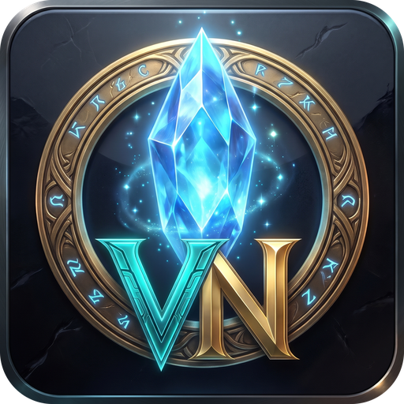
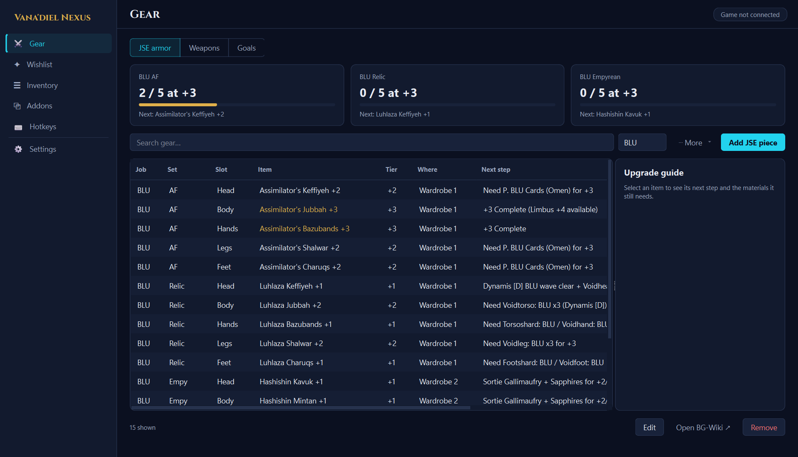

# Vana'diel Nexus

A companion app for **Final Fantasy XI** players using **Windower 4**. Run it on a second monitor or
alt-tab to it: it tracks the gear you have and the gear you're chasing, counts the materials you
already hold across every bag and character, and keeps your Windower addons, their settings and your
key bindings in one place.

It is a normal desktop window, not an in-game overlay. In-game overlays stay as Windower addons; the app
installs, configures and reloads them for you.

## What it does

| Page | What you get |
|------|--------------|
| **Gear** | JSE armor by job, REMA weapons and your own goals, with progress cards. An upgrade guide beside the table shows each item's next step and a materials checklist counted from your bags. Goals can count an item straight from your inventory. |
| **Wishlist** | Gear you want, where it drops and what it costs. Item names autocomplete from a catalog, BG-Wiki / FFXIAH / FFXIclopedia links import in one paste, items you already own are flagged, and anything can become a tracked goal. |
| **Inventory** | Every item across all bags and characters, with stacks rolled up, items split across bags flagged, and anything you're tracking marked. Refreshes from the game or imports a CSV. |
| **Addons** | All your addons and plugins with descriptions, what starts with the game, load / unload / reload, and a settings editor for each addon (switches, numbers, colors) that backs up before saving. **Scan for updates** checks addons against their GitHub source and updates only changed files, never your saved settings. A **My Addons** tab helps you write and install your own addons. |
| **Hotkeys** | Every key bind from the game, Windower `init.txt`, GearSwap job files and addons, with only real conflicts flagged (job files that never load together don't count). Change a key or turn a bind off, with a backup. |
| **Settings** | Windower folder, text size, where your data lives, and updates. |

## Install

1. Download `VanadielNexus.exe` from the [latest release](https://github.com/Grimdarts/VanadielNexus/releases/latest)
   and put it in its own folder (next to your `Windower4` folder works well).
2. Run it. The **Setup** checklist finds Windower, installs the small `VanadielNexus` Windower addon that
   lets the app see your character and bags, and can add it to your startup scripts.
3. In game, type `//lua load vanadielnexus` (or restart the game).

Windows may show a SmartScreen warning the first time because the exe isn't code-signed. Choose
*More info* then *Run anyway*.

**Updates:** the app checks GitHub when it starts and offers new versions. Only the exe is replaced;
your data is backed up and never overwritten.

**Your data stays on your PC.** Tracker, wishlist, inventory and settings live in the `data` folder next
to the exe, and every save keeps the previous copy as a `.bak`. The app only goes online to check for
app and addon updates on GitHub.

Requirements: Windows 10 or 11, Windower 4.

## For developers

| Task | Command |
|------|---------|
| Install dev tools | `py -m pip install -r requirements.txt` |
| Run from source | `py -m vanadiel_nexus` |
| Run the tests | `py -m pytest tests` |
| Rebuild your local exe | `.\build.ps1` (closes, rebuilds, relaunches) |
| Ship a version to players | `.\release.ps1 2.2.0` |

- Python 3.14 and Qt (PySide6). Layout: `vanadiel_nexus/core` (logic, no Qt, unit-tested), `ui` (pages and
  widgets), `bridge` (local UDP link to the Windower addon on ports 5017/5018), `resources` (the Windower
  addon, default database, icon, font).
- After cloning, enable the auto-rebuild hook once: `git config core.hooksPath tools/hooks`. Every commit that
  changes a `.py` or `.spec` file then rebuilds `VanadielNexus.exe` in the background.
- `release.ps1` bumps the version, tags `vX.Y.Z` and pushes. GitHub Actions runs the tests, builds the exe and
  publishes the release that players update from.
- Design notes: [`DESIGN.md`](DESIGN.md) (look and feel) and [`docs/ENGINEERING-PLAN.md`](docs/ENGINEERING-PLAN.md).

## Credits

Title font: [Cinzel](https://github.com/NDISCOVER/Cinzel) (SIL Open Font License). Final Fantasy XI is a
trademark of Square Enix; this is an unofficial fan project and isn't affiliated with Square Enix or Windower.
