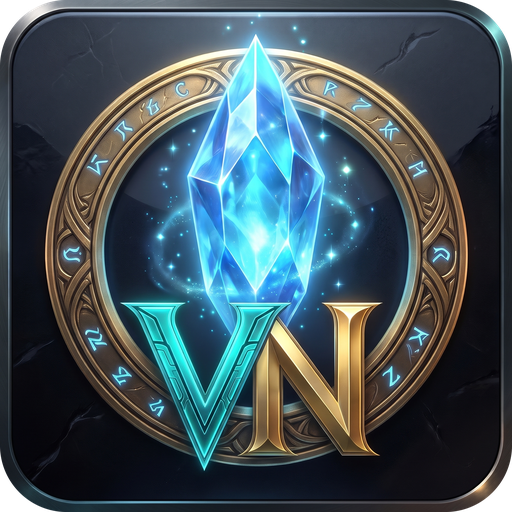
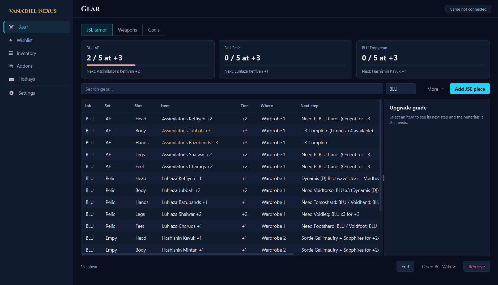

# Vana'diel Nexus

A companion app for **Final Fantasy XI** players using **Windower 4**. Run it on a second monitor or
alt-tab to it: it tracks the gear you have and the gear you're chasing, counts the materials you
already hold across every bag and character, and keeps your Windower addons, their settings and your
key bindings in one place.

It is a normal desktop window, not an in-game overlay. In-game overlays stay as Windower addons; the app
installs, configures and reloads them for you.

## What it does

| Page | What you get |
|------|--------------|
| **Gear** | JSE armor by job, REMA weapons and your own goals, with progress cards. An upgrade guide beside the table shows each item's next step and a materials checklist counted from your bags. Goals can count an item straight from your inventory. |
| **Sets** | Every set in your GearSwap job file, read the way GearSwap reads it (the app never changes your Lua), grouped by what it's for and drawn as the in-game 4×4 equipment grid. Each slot says whether you own the piece in a bag GearSwap can equip from, have it stored away, own it on another character, or don't have it. |
| **Wishlist** | Gear you want, where it drops and what it costs. Item names autocomplete from the game's own equipment list, BG-Wiki / FFXIAH / FFXIclopedia links import in one paste, items you already own are flagged, and anything can become a tracked goal. |
| **Inventory** | Every item across all bags and characters, with stacks rolled up, items split across bags flagged, and anything you're tracking marked. Refreshes from the game or imports a CSV. |
| **Addons** | All your addons and plugins with descriptions, what starts with the game, load / unload / reload, and a settings editor for each addon (switches, numbers, colors) that backs up before saving. **Scan for updates** checks addons against their GitHub source and updates only changed files, never your saved settings. A **My Addons** tab helps you write and install your own addons. |
| **Layout** | Arrange every addon window that draws on the game screen, on a picture of your screen or in game (`//vn layout`). Each job keeps its own layout, windows move when you change job, and an addon can be shown on some jobs and hidden on others. |
| **Hotkeys** | Every key bind from the game, Windower `init.txt`, GearSwap job files and addons, with only real conflicts flagged (job files that never load together don't count). Change a key or turn a bind off, with a backup. |
| **Guide upgrades** | Recommended gear sets for all 22 jobs (512 in 2.2.0), compared against one character's saved inventory. Pick a set by what it's for (idle, TP, a weapon skill, fast cast, cures…). Each slot says whether you're ready, own it in the wrong bag, need the right augments or a second copy, or are missing it. Save sets as targets with your own augment or bag notes; corrected guides never change a saved target until you review and accept the update. |
| **G13 controls** | *Optional.* For Logitech G13 users whose GearSwap job files export their key labels (see [Optional integrations](#optional-integrations)). |
| **Settings** | Windower folder, text size, default wiki site, where your data lives, and updates. |

Right-click any item on Gear, Sets, Wishlist, Inventory or Guide upgrades to open it on BG-Wiki, FFXIAH or FFXIclopedia; **Settings** picks the site that double-click (on Inventory and Guide upgrades) and the Open wiki buttons use.

## What's new in 2.2.0

- **Guide upgrades** now covers all 22 jobs, with saved targets, your own augment and bag notes, and a review
  step whenever a guide set is corrected.
- **Sets** reads every set in your GearSwap job file, flags gear stored where GearSwap can't reach it, and
  warns before you paste a line that would need a second copy of an item.
- **Wishlist** item names autocomplete from the game's equipment list.
- **Inventory** includes items stored on moogle storage slips.
- **Layout** arranges addon windows per job, in the app or in game (`//vn layout`).
- Windower addon **1.5.1**. The app offers to update it from the Setup checklist.

**Known issues** and **what's coming next** are listed in the player guide:
[Known issues and what's next](docs/USER-GUIDE.md#known-issues-and-whats-next). The World Map page is held
back for a later release.

**New here? Read the [player guide](docs/USER-GUIDE.md).** It walks through setup, every page, the in-game
commands, where your data lives, and what to do when something doesn't connect.

## Install

1. Download `VanadielNexus.exe` from the [latest release](https://github.com/Grimdarts/VanadielNexus/releases/latest)
   and put it in its own folder (next to your `Windower4` folder works well).
2. Run it. The **Setup** checklist finds Windower, installs the small `VanadielNexus` Windower addon that
   lets the app see your character and bags, and can add it to your startup scripts.
3. In game, type `//lua load vanadielnexus` (or restart the game).

Windows may show a SmartScreen warning the first time because the exe isn't code-signed. Choose
*More info* then *Run anyway*.

A new install starts with an empty tracker; your gear, goals and wishlist are yours to add. Full walkthrough: [player guide → Install and first run](docs/USER-GUIDE.md#install-and-first-run).

**Updates:** the app checks GitHub when it starts and offers new versions. Only the exe is replaced;
your `data` folder is never touched.

**Your data stays on your PC.** Tracker, wishlist, inventory and settings live in the `data` folder next
to the exe, and every save keeps the previous copy as a `.bak`. The app only goes online to check for
app and addon updates on GitHub.

Requirements: Windows 10 or 11, Windower 4.

Guide data is a dated snapshot with source links; owning an augmentable base item does not certify
completion of a guide's path/rank/augment target.

### Optional integrations

The **G13 controls** page is for GearSwap setups built on `addons/GearSwap/data/Nova-Common.lua` and its
shared gear/job files. Those job files export their real G-key labels and mode selections to a local
`Nova-controls-live.json`, and the page shows them (it never guesses key bindings). Preview M1/M2/M3 or
follow the last G-key; stale exports are cleared, and the physical mode LED and thumb mappings are not
inferred. The in-game G13 map starts visible; `Alt+F12` toggles it. Without that setup the page simply waits,
and every other page works normally.

## For developers

| Task | Command |
|------|---------|
| Install dev tools | `py -m pip install -r requirements.txt` |
| Run from source | `py -m vanadiel_nexus` |
| Run the tests | `py -m pytest tests` |
| Rebuild your local exe | `.\build.ps1` (closes, rebuilds, relaunches) |
| Ship a version to players | `.\release.ps1 2.2.0` |

- Python 3.14 and Qt (PySide6). Layout: `vanadiel_nexus/core` (logic, no Qt, unit-tested), `ui` (pages and
  widgets), `bridge` (local UDP link to the Windower addon on ports 5017/5018), `resources` (the Windower
  addon, default database, icon, font).
- After cloning, enable the auto-rebuild hook once: `git config core.hooksPath tools/hooks`. Every commit that
  changes a `.py` or `.spec` file then rebuilds `VanadielNexus.exe` in the background.
- `release.ps1` bumps the version, tags `vX.Y.Z` and pushes. GitHub Actions runs the tests, builds the exe and
  publishes the release that players update from.
- Design notes: [`DESIGN.md`](DESIGN.md) (look and feel) and [`docs/ENGINEERING-PLAN.md`](docs/ENGINEERING-PLAN.md).

## Credits

Title font: [Cinzel](https://github.com/NDISCOVER/Cinzel) (SIL Open Font License). Final Fantasy XI is a
trademark of Square Enix; this is an unofficial fan project and isn't affiliated with Square Enix or Windower.
