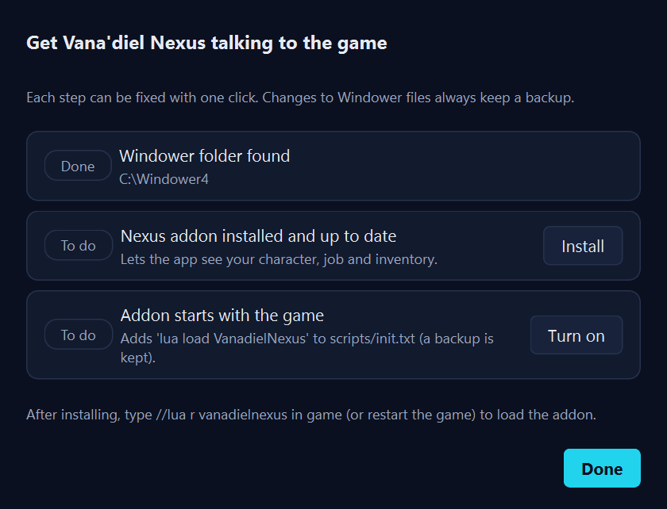
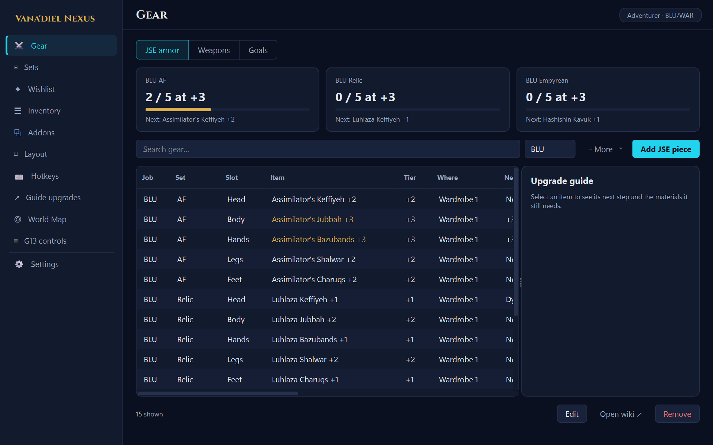
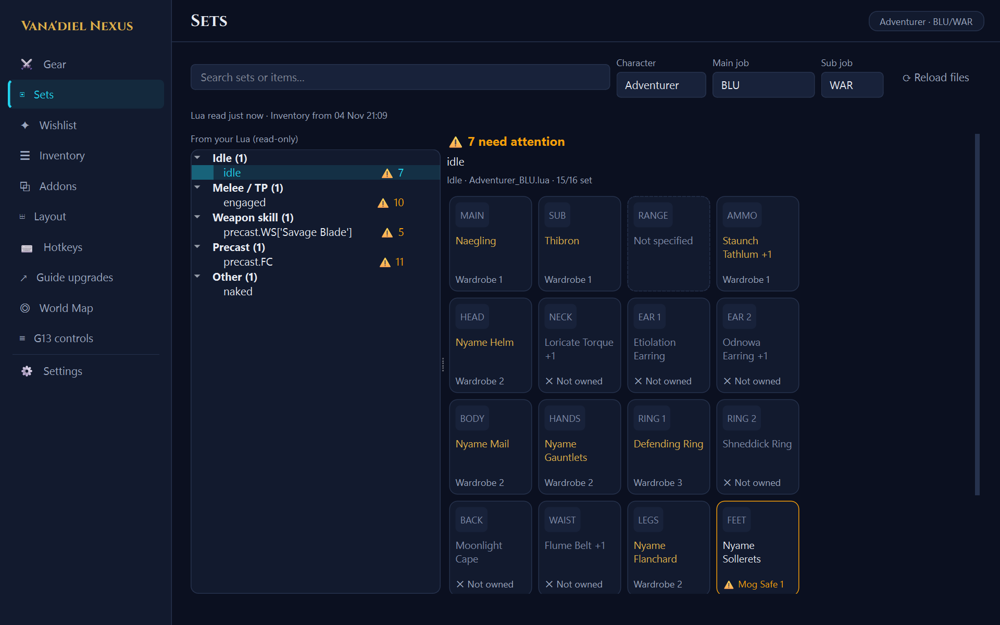
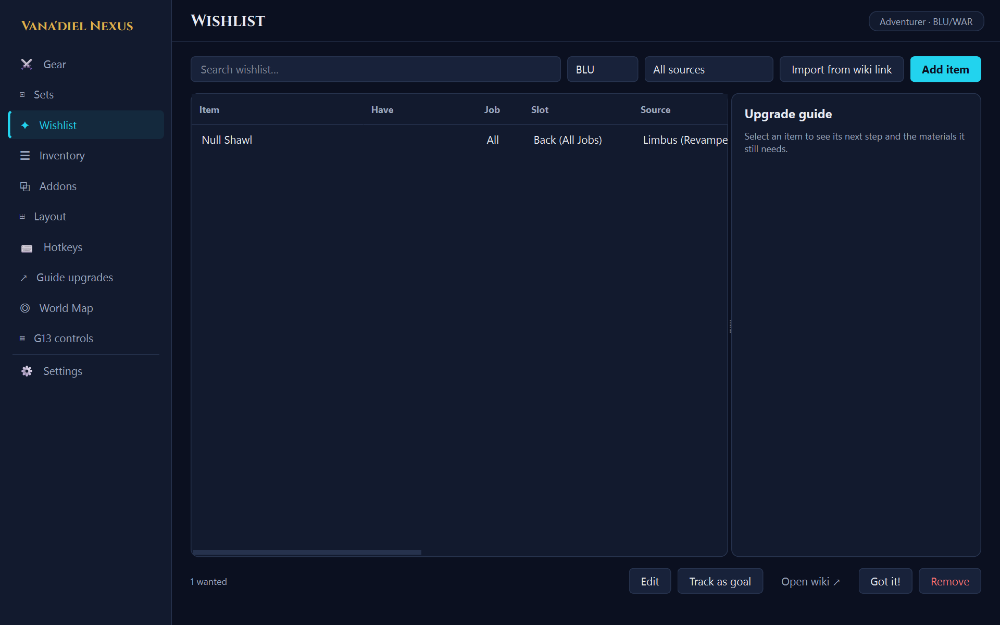
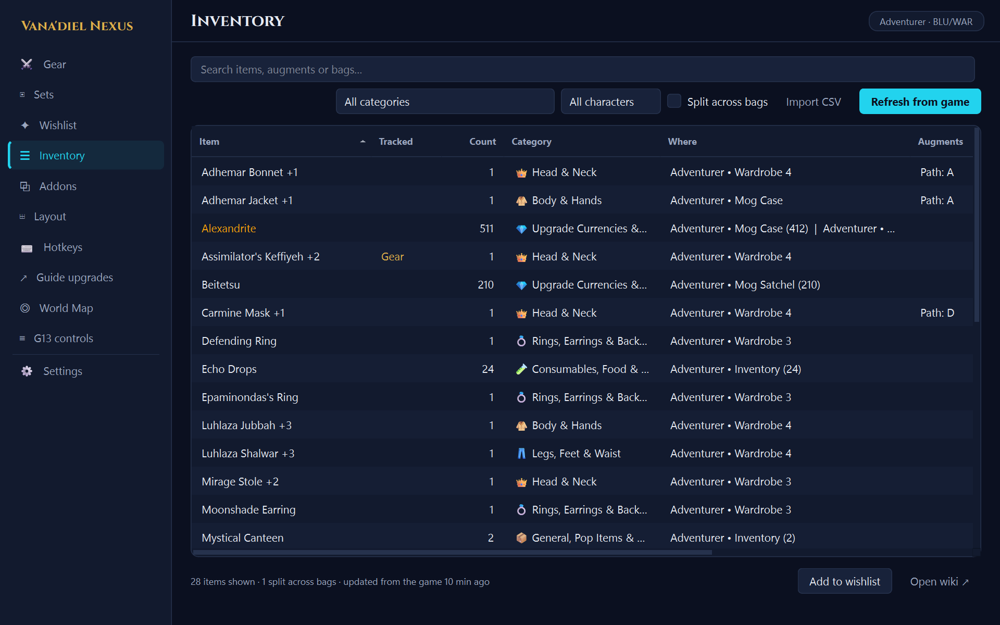
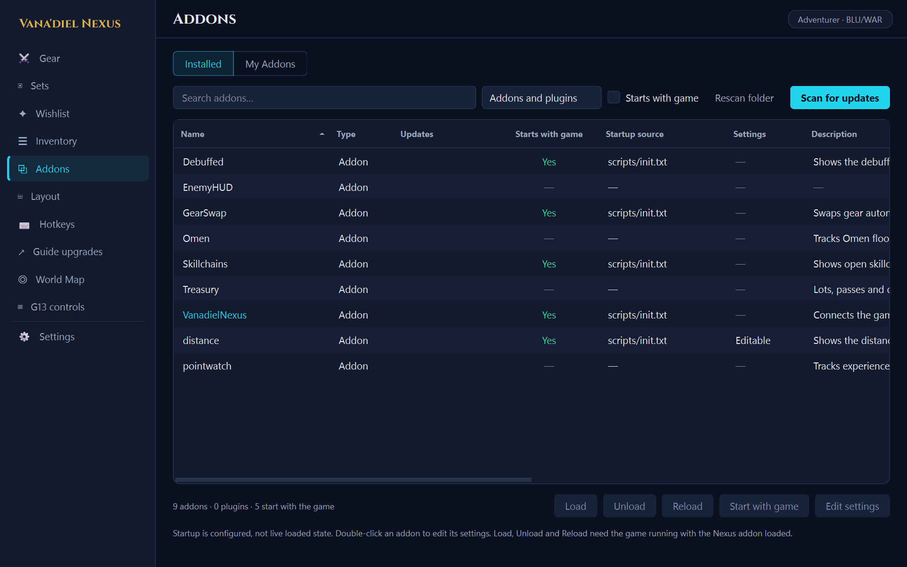
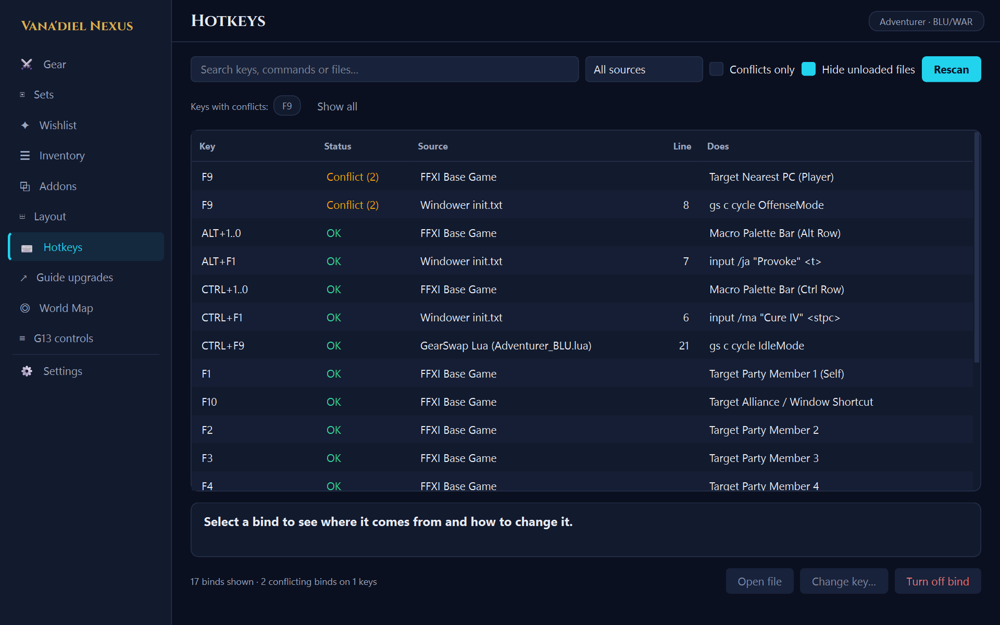

# Vana'diel Nexus player guide

Vana'diel Nexus is a desktop companion for **Final Fantasy XI** players who use **Windower 4**. Keep it on a
second monitor or alt-tab to it. It tracks the gear you own and the gear you're chasing, reads your GearSwap
sets, counts upgrade materials across every bag and character, and manages your Windower addons, their
settings, their on-screen positions and your key binds.

It is an ordinary window, not an in-game overlay. A small Windower addon (also called VanadielNexus) tells
the app what your character is carrying; everything else happens on your PC.

**Contents**

1. [What you need](#what-you-need)
2. [Install and first run](#install-and-first-run)
3. [Finding your way around](#finding-your-way-around)
4. [Your tracker starts empty](#your-tracker-starts-empty)
5. [Pages](#pages): [Gear](#gear) · [Sets](#sets) · [Wishlist](#wishlist) · [Inventory](#inventory) ·
   [Addons](#addons) · [Layout](#layout) · [Hotkeys](#hotkeys) · [Guide upgrades](#guide-upgrades) ·
   [G13 controls](#g13-controls) · [Settings](#settings)
6. [In-game commands](#in-game-commands)
7. [Your data and backups](#your-data-and-backups)
8. [Updates](#updates)
9. [Troubleshooting](#troubleshooting)
10. [Uninstalling](#uninstalling)

---

## What you need

- Windows 10 or 11
- FFXI with [Windower 4](https://www.windower.net/)
- GearSwap, if you want the Sets page (it ships with Windower; the app only reads your job files)

You don't need Python or anything else. The app is a single `.exe`.

## Install and first run

1. Download `VanadielNexus.exe` from the
   [latest release](https://github.com/Grimdarts/VanadielNexus/releases/latest).
2. Make a folder for it and put the exe inside. A folder beside your `Windower4` folder works well, because
   the app looks there first. Avoid `Program Files`: the app keeps its data next to the exe, and Windows
   doesn't let programs write there (it would fall back to `%APPDATA%\VanadielNexus`).
3. Run it. Windows may show a blue **SmartScreen** warning because the exe isn't code-signed. Choose
   **More info**, then **Run anyway**. You only see this once per version.

### The Setup checklist

The first time you open the app, a **Setup** window lists three steps. Each step has one button.



| Step | What the button does |
|------|----------------------|
| **Windower folder found** | Finds your `Windower4` folder. The app looks beside its own folder, inside it, then in `C:\Windower4`, `Program Files`, `Program Files (x86)` and `Games\Windower4` in your user folder. If it can't find it, click **Choose folder…** and pick the folder that contains `windower.exe`. |
| **Nexus addon installed and up to date** | **Install** copies the VanadielNexus addon into `Windower4\addons\VanadielNexus`. |
| **Addon starts with the game** | **Turn on** adds `lua load VanadielNexus` to `Windower4\scripts\init.txt` so the addon loads every time you play. A backup of `init.txt` is saved first. |

Then load the addon in game. Restart FFXI, or type:

```
//lua load vanadielnexus
```

Within a few seconds the pill at the top right of the app changes from **Game not connected** to your
character name and job, for example **Adventurer · BLU/WAR**, and your bags appear on the Inventory page.

If you close the checklist before finishing, a **Setup 1 of 3** pill stays in the top bar. Click it to
reopen the checklist.

## Finding your way around

- **Sidebar** (left): one entry per page. When the window is narrower than about 1100 pixels, the sidebar
  shrinks to icons. Hover an icon to see its name.
- **Top bar** (right): the game connection, unfinished setup, and an update notice when a new version is out.
- **Status line** (bottom): short confirmations, such as "Added Null Shawl to your wishlist."
- **Tables**: click a column header to sort. Drag the dividers between headers to resize columns; the app
  remembers the widths. Type in the search box above a table to filter it.
- **Right-click** an item on Gear, Wishlist, Inventory, Sets or Guide upgrades to open it on BG-Wiki, FFXIAH
  or FFXIclopedia.
- **Text too small?** Settings → Appearance → **Text size** goes up to 130%.
- The app remembers the page you were on and the window's size and position.
- Only one copy runs at a time. Opening the exe again brings the running copy to the front.

## Your tracker starts empty

A new install has no gear, goals or wishlist items: the Gear and Wishlist pages fill up as you add your own.
Inventory, Sets, Addons and Hotkeys fill themselves from your game and Windower files as soon as setup is
done. (The screenshots in this guide come from a made-up character.)

---

## Pages

### Gear

Your long-term gear progress, in three tabs.



| Tab | What it tracks |
|-----|----------------|
| **JSE armor** | Artifact, Relic and Empyrean pieces by job: slot, current tier (NQ to +3), where the piece is, and the next step. Pick a job in the job menu to see a progress card for each set ("2 / 5 at +3"). Pieces at +3 show in gold. |
| **Weapons** | Relic, Mythic, Empyrean, Aeonic, Ergon and Prime weapons: stage, progress %, and the next step. The three furthest from done show as cards. |
| **Goals** | Anything you can count: Alexandrite toward a mythic, NMs cleared, points earned. Each goal has a current and target number. Pinned goals show as cards at the top. |

**Adding things.** Click the **Add** button (its label changes per tab). Double-click a row, or click
**Edit**, to change it.

**Materials checklists.** Any piece, weapon or goal can list the materials it still needs. Type one per
line in any of these forms:

```
Plutons x1500
1500 Beitetsu
Riftborn Boulder: 300
```

The **Upgrade guide** panel on the right then shows each material with how many you already hold. The
count covers **every bag on every character** the app has seen, so materials on a mule count too. Click
**Edit materials** in the panel to change the list.

**Goals that count themselves.** Tick **Count the unit from my bags** and set **Unit** to an item name (for
example `Alexandrite`). The goal's current number then updates from your inventory every time it refreshes.
For goals you count by hand, select the goal and use the **+1** and **−1** buttons.

The job menu follows the job you're playing. Choose **All jobs** to see everything.

### Sets

Every set in your GearSwap job file, drawn as the in-game 4×4 equipment grid, with what you actually own
for each slot.



**This page only reads your files.** It runs your job file in a sandbox the same way GearSwap does, but it
never changes your Lua. When it suggests a fix, it gives you a line to paste in yourself.

**Choosing what to look at.** Use **Character**, **Main job** and **Sub job** at the top. When the game is
connected, the page follows your current character and job. If you pick a job by hand, it stops following;
click **Follow game** to resume. The app finds the same file GearSwap would load, checking names like
`Name_BLU.lua`, `Name_Blue Mage.lua`, `BLU.lua` and `default.lua` in GearSwap's usual folders. If it finds no
file, it lists every folder it searched.

**The set list** on the left groups sets by what they're for: Idle, Melee / TP, Weapon skill, Precast,
Midcast and so on. The ⚠ number beside a set counts the slots that need attention. Type in the search box to
find a set, or an item across all sets.

**Reading a slot.** Each slot says what it is in words, and the colour only backs that up:

| Slot says | Meaning |
|-----------|---------|
| A bag name, such as **Wardrobe 2** (gold item name) | You own it, in a bag GearSwap can equip from (your inventory or a wardrobe). |
| ⚠ **Mog Safe 1** (or another storage bag) | You own it, but it's stored where GearSwap can't equip it. Move it to a wardrobe. |
| **On another character** | A different character of yours has it. |
| ✕ **Not owned** | Nobody you've logged in with has it. |
| **Unknown item** | The name doesn't match any item in the game's data. Usually a typo in the Lua. |
| **Not specified** | The set doesn't mention this slot, so GearSwap leaves whatever is equipped. |
| **↑** badge | You own a higher tier of this item than the set asks for. |

**Fixing a slot.** Click a slot (or move with the arrow keys and press Enter) to open its panel. It lists
the items you own that fit the slot for this job and says where each one is. Pick a
replacement, then click **Copy slot line**. The panel tells you exactly where to paste it, including when
the slot comes from a shared table or a `set_combine` and the fix belongs elsewhere. Paste it into your Lua
with **Open job file**, save, and type `//gs reload` in game.

**Keys:** **F5** re-reads the files (also the **⟳ Reload files** button). **Esc** closes the slot panel.

Ownership comes from your last inventory snapshot. If something you just bought shows as not owned, click
**Refresh from game** on the Inventory page, or type `//vn scan`.

### Wishlist

Gear you want, where it comes from and what it costs.



- **Add item**: start typing and the name autocompletes from every piece of equipment in the game (the
  list comes from your Windower folder, so it's always current). Picking a suggestion fills in the slot.
  Where it drops, the zone and the cost are yours to add.
- **Import from wiki link**: paste a BG-Wiki, FFXIAH or FFXIclopedia item link (or just a name) to start a
  new entry with the link saved and the name spelled the way the game spells it.
- The **Have** column says **In your bags** when you already own the item on any character. The count under
  the table tells you how many of those there are.
- **Got it!** removes the item because you've got it. **Remove** deletes it without the celebration.
- **Track as goal** copies the item and its materials to Gear → Goals as a pinned goal, so its progress
  sits with everything else.
- Filter by job and by source (Omen, Sortie, Odyssey…) with the menus at the top. Tick **Pin to top** when
  editing an item to keep it first.

### Inventory

Every item across all 17 bags (inventory, wardrobes 1–8, both mog safes, storage, locker, satchel, sack,
case and the recycle bin) and your storage slips, for every character you've logged in with.



- **Refresh from game** asks the addon for a fresh scan. The addon also sends one when it loads, when you
  change job, and after you zone.
- Stacks are added together: 412 Alexandrite in the Mog Case plus 99 in the Mog Sack shows as **511**, and
  **Where** lists each spot.
- Items **split across bags** show in amber. Tick **Split across bags** to see only those, which is handy for
  consolidating stacks.
- **Tracked** marks items that appear in your Gear tracker or wishlist.
- Filter by category or character with the menus. The search box also matches augments and bag names.
- Double-click an item to open it on your default wiki. Right-click for **Add to wishlist** and the other
  sites.
- The line under the table shows how fresh the data is, for example "updated from the game 12 min ago".

**Storage slips.** Items stored on slips are listed as if they were in a bag named after the slip, such as
"Storage Slip 07", so you can find them.

**Import CSV.** Each row can be `Character,Bag,Item,Count[,Augments]` or `Item,Count[,Character,Bag]`.
Importing the same file again replaces its rows. A character who has logged in with the addon always uses
the live data instead of an imported file.

### Addons

Everything in your Windower `addons` and `plugins` folders, in one table.



**Installed tab**

- **Starts with game** and **Startup source** show where each addon gets loaded from (usually
  `scripts/init.txt`). This is your startup configuration; the app can't see which addons are running right
  now.
- **Start with game** / **Don't start with game** edits `scripts/init.txt` (with a backup). Plugins are set in
  the Windower launcher profile instead.
- **Load**, **Unload** and **Reload** send the command to the game. They need the game running with the
  VanadielNexus addon loaded.
- **Edit settings** (or double-click an addon) opens its settings file as a list of switches, numbers, text
  and colours, instead of raw XML. A backup is saved before every change. **Save and reload in game** applies
  the change right away. Addons that keep one settings file per character let you pick which file to edit.
  Most addons create their settings file the first time they run, so load an addon once before editing it.

**Keeping addons up to date.** Click **Scan for updates**. The app compares each addon's files with its
source on GitHub: for official addons, the same Windower source the launcher installs. Addons with changes
show **Update** in the Updates column. **Update** or **Update all** then:

1. zips each addon folder into your `data\backups` folder,
2. replaces only the files that changed,
3. leaves the addon's saved settings (its `data` folder) alone.

Reload updated addons in game afterwards, or restart the game. For an addon that isn't official, right-click
it, choose **Set update source…**, and paste its GitHub link (`https://github.com/owner/repo`, or
`owner/repo/folder` when the addon lives in a subfolder).

**My Addons tab**

For writing your own addons. Your working copies live in `Documents\VanadielNexus\MyAddons` (change it
with **Change folder…**).

- **New addon…** creates a ready-to-run addon from a template.
- **Install / update** copies your files into Windower. **Install and reload in game** also reloads it.
- Installing never touches the installed addon's `data` folder, so its saved settings survive.

### Layout

Arrange the windows that addons draw on the game screen (Parse, Skillchains, EnemyHUD, Debuffed, distance,
xivbar, and about 20 others) and give each job its own arrangement.

- **Job** chooses which layout you're editing. A job without its own layout uses **Default** until you save
  one.
- Drag the boxes on the picture of your screen, or select one and use the arrow keys (hold Shift to move
  10 px). Boxes snap to screen edges, the centre lines and each other. X and Y show the exact position.
- **Tick or untick a window** in the list to show or hide it on this job. For example, show your pet bar on
  SMN and BST only.
- **Switch with my job**: when ticked, your windows move to that job's layout whenever you change job in
  game.
- **Copy from…** starts this job's layout from another job's.
- **Capture current** takes the positions your windows have right now, after you've dragged them in game.
- **Background…** puts one of your own FFXI screenshots behind the boxes to line things up against.
- **Save** keeps the layout for this job. If it's the job you're playing right now, the app also writes the
  positions into each addon's settings and reloads those addons in game, so their windows jump to the new
  spots. Other jobs' layouts apply the next time you change to that job (with **Switch with my job** on).
- **Use Default for this job** deletes this job's own layout so it goes back to Default.

**Arrange in game** (or `//vn layout` in the chat line) does the same thing inside FFXI. Every window gets a
frame you can move:

| Key | Does |
|-----|------|
| Tab | Select the next frame |
| Arrow keys | Move it 1 px (hold Shift for 10 px) |
| Enter, or the **Save layout** button | Save and send the positions to the app |
| Esc, or **Cancel** | Close without saving |
| Hold the **right** mouse button, then drag with the left | Move a frame with the mouse (left-drag on its own walks your character) |

The app has to be open for in-game arranging. Log in once with the addon loaded before using layouts, so
the app knows whose layout it's saving.

### Hotkeys

Every key bind in one table: the game's own keys, Windower's `init.txt`, every GearSwap file, and Windower
itself.



- **Only real conflicts are flagged.** Two job files that never load together can use the same key without
  a warning. Files in folders GearSwap never searches (backups, exports, old copies) are hidden unless you
  untick **Hide unloaded files**.
- The chips at the top list each key with a conflict. Click one to see only that key's binds.
- Select a bind to see what it does, which file and line it's on, and what it clashes with.
- **Change key…** moves the bind to a new key (type something like `Ctrl+F7` or `Alt+7`). **Turn off bind**
  comments the line out. Both save a backup of the file first. Then reload the file in game: `//gs reload`
  for GearSwap files, or restart the game for `init.txt`.
- **Open file** opens the file the bind lives in.

### Guide upgrades

The 2.2.0 catalog contains **512 effective recommendations across all 22 jobs**, with explicit action,
weapon and recipient contexts. This is bounded coverage, not every job/tier/encounter or a current-best
claim. DRG/PUP/DNC second passes, additional RUN variants and other declared limits remain pending.

1. Choose the job, purpose and contextual set. Version buttons appear only for distinct selectable
   versions. Retired corrections remain history and are hidden from the picker.
2. Read the origin, currency, verification scope, assumptions and **Sources** before choosing a target.
   A recent source date does not prove the recommendation is current or safe to swap in combat.
3. Select a character snapshot. **Ready in snapshot** means a matching copy is in a supported equippable
   bag; **Owned · check bag** means location/readiness still needs review. **Upgrade / verify** includes
   unmet or unreported literal augments/rank/path and copies already allocated to another slot.
   **Unverified** means no inventory snapshot. Two selected ring slots require two physical copies.
4. **Track this set** explicitly saves a separate revision target. Existing Wishlist/legacy targets are
   preserved; there is no automatic slot inference, migration or retargeting.
5. A saved retired target shows an amber notice. **Review update…** previews the effective replacement;
   only **Save this revision** adopts it. Personal overrides and bag bindings remain separate.

Item details and Equipment analysis show supported known contributions and unknown effects explicitly.
They do not certify caps, HP-preserving swaps, ownership beyond the selected snapshot, or live readiness.
The application never writes player Lua from these guide or Sets comparison flows.

### World Map (deferred)

World Map is excluded from 2.2.0 and remains a later project.

### G13 controls

**Optional, for Logitech G13 users with a matching GearSwap setup.** This page shows the key labels and
mode selections that a compatible GearSwap job file exports (it reads a `Nova-controls-live.json` file the
job file writes). Without that setup, the page just says it's waiting for controls, and you can ignore it.

### Settings

- **Game**: your Windower folder (**Change…** to pick another) and a link back to the Setup checklist.
- **Appearance**: text size, and the wiki site that double-click and the Open wiki buttons use.
- **Your data**: where your data folder is, with an **Open** button. If the app ever had to load a backup
  at startup, a note here says so and where the unreadable file was kept.
- **About**: your version and **Check for updates**.

---

## In-game commands

Type these in the FFXI chat line.

| Command | Does |
|---------|------|
| `//vn scan` | Scan all bags and storage slips and send them to the app now. |
| `//vn layout` | Open the in-game layout frames (see [Layout](#layout)). `//vn layout save` or `//vn layout cancel` closes them. |
| `//vn` | Show the command list. |
| `//lua load vanadielnexus` | Load the addon (first time, or if it isn't in your startup). |
| `//lua reload vanadielnexus` | Reload it, for example after the app installed a newer copy. |

`//nexus` and `//vanadielnexus` work in place of `//vn`. The addon binds **no** keys, so your F-keys stay
free for GearSwap.

## Your data and backups

Everything stays on your PC, in the `data` folder next to the exe (Settings → Your data → **Open**).

| File | Holds |
|------|-------|
| `ffxi_database.json` | Your Gear tracker, goals and wishlist |
| `inventory_snapshot.json` | The last scan of each character's bags |
| `settings.json` | Windower folder, window position, column widths, choices you've made on each page |
| `layouts.json` | Your addon layouts per character and job |
| `backups\` | Zips of addon folders taken before each addon update |

**Every save keeps the previous copy** as a `.bak` file beside the original. If a file is ever damaged, the
app loads the `.bak` automatically and tells you on the Settings page.

**Windower files the app changes** (`init.txt`, addon settings, GearSwap files when you change a bind) get a
timestamped backup beside them first, named like `init.txt.20261104-213000.bak`.

**Moving to a new PC:** copy the whole folder (exe and `data`) across.

**Several characters:** log in once on each with the addon loaded. Each character's bags are kept
separately, and the Inventory, Sets and Guide upgrades pages let you pick between them. Material counts
on Gear and Wishlist add up all of them.

**Network use:** the app only goes online to check GitHub for app updates (at startup) and addon updates
(when you click Scan for updates). The game link is local to your PC (UDP ports 5017 and 5018 on
`127.0.0.1`).

## Updates

**The app.** A few seconds after it starts, the app checks GitHub for a newer release. When there is one, a
**v… available** pill appears in the top bar. Click it to read what changed and choose **Yes**. The app
downloads the new exe, closes, swaps it in and reopens. Your `data` folder is never touched. You can also
use Settings → **Check for updates**.

**The Windower addon.** Some releases include a newer VanadielNexus addon. When yours is older, the top bar
shows **Setup 2 of 3**. Open it, click **Install**, then type `//lua reload vanadielnexus` in game.

## Troubleshooting

**The top bar still says "Game not connected".**
- Check the addon is loaded: type `//vn` in game. You should see the command list. If not, run
  `//lua load vanadielnexus`.
- Open the Setup checklist (top bar or Settings) and make sure all three steps say Done.
- If the status line says *Another program is using port 5017*, something else on your PC holds that port.
  Close it, or close any second copy of the app, and restart.
- If a firewall or antivirus asks about the app, allow it. The connection only listens on `127.0.0.1` and
  never leaves your PC.

**Inventory is empty or old.** Click **Refresh from game** or type `//vn scan`. A full scan happens after
the game finishes loading your bags, so give it a few seconds after you log in or zone.

**The Sets page says it found no GearSwap file.** It lists every folder it searched. Check your job file is
named the way GearSwap expects, such as `YourName_BLU.lua` or `BLU.lua`, and is in one of those folders.
If the page says *Read incomplete*, click **Details** to see the Lua error, then **Retry**.

**An item I own shows as Not owned on Sets.** Refresh your inventory, and check the spelling in your Lua
matches the in-game name. **Unknown item** means the name matches nothing in the game's data.

**Load, Unload or Reload does nothing.** Those buttons need the game running with the addon loaded. The
app can't tell which addons are currently running, only which ones start with the game.

**My layout didn't move an addon.** Only addons in the Layout list can be positioned. Make sure the
addon's settings file exists (load the addon once), then save the layout again.

**SmartScreen blocks the exe.** Choose **More info**, then **Run anyway**. If your antivirus quarantines it,
restore it and add an exception for the app's folder. Download it only from the project's
[Releases page](https://github.com/Grimdarts/VanadielNexus/releases).

**Something else.** Open an issue on [GitHub](https://github.com/Grimdarts/VanadielNexus/issues). Say what
you did, what you expected, and what happened instead, and include a screenshot if you can. Don't attach your
`data` folder unless you're happy for others to see your character names and inventory.

## Uninstalling

1. In game, `//lua unload vanadielnexus`. On the app's Addons page, select **VanadielNexus** and click
   **Don't start with game** (or delete the `lua load VanadielNexus` line from `Windower4\scripts\init.txt`).
2. Delete the `Windower4\addons\VanadielNexus` folder.
3. Delete the app's folder (the exe and `data`). If the app ever used `%APPDATA%\VanadielNexus`, delete that
   too, along with `Documents\VanadielNexus` if you made your own addons and no longer want them.

The app installs nothing else and leaves no registry entries.

---

Final Fantasy XI is a trademark of Square Enix. Vana'diel Nexus is an unofficial fan project and isn't
affiliated with Square Enix or Windower.
